# 个人网站开发过程走查（需求分析 → 架构设计）

> 配套：[开发过程活动图.md](开发过程活动图.md)、[个人网站系统架构.md](个人网站系统架构.md)
> 案例：教师个人主页（博客 + 作品集 + 简历），约束为"改文章只改 Git，不碰服务器"
> 本文按活动图逐节点走一遍，每张图给出 Mermaid 与 PlantUML 两版源码

---

## 0. 走查路线

| 活动图节点 | 本文对应章节 | 产出 |
| --- | --- | --- |
| 需求与用例梳理 | 1 | 用例图 + 用例清单 + 非功能约束 |
| 领域建模（概念模型） | 2 | 领域类图 |
| 需求级交互与生命周期 | 3 | 顺序图 + 状态图 |
| 架构设计（四视图） | 4 | 逻辑 / 开发 / 物理 / 运行 |
| 盘点可替换点 + 复用选型 | 5 | 选型表 + 一次回退 |
| 架构约束检查（七类） | 6 | 检查表 |
| 全局接口契约骨架 | 7 | 三层契约 + 权限矩阵 |
| 脚手架 | 8 | 目录与工具链 |
| 切片（按用例纵切） | 9 | 六个切片 |
| 详细设计（S1） | 10 | 内容模型 + 构件 |
| 四视图一致性核对 | 11 | 核对表 + 缺口 |

---

# 一、需求分析

## 1. 用例图

### 1.1 参与者与用例

| 参与者 | 说明 | 主要用例 |
| --- | --- | --- |
| 访客 | 未登录，只读 | 浏览列表、阅读详情、按标签筛选、搜索、订阅 RSS、评论、查看作品集与简历 |
| 站主 | 站点作者 | 编写 Markdown、构建并发布 |
| CI 机器人 | 自动化构建 | 构建并发布（与站主共用同一用例，权限不同） |

### 1.2 Mermaid

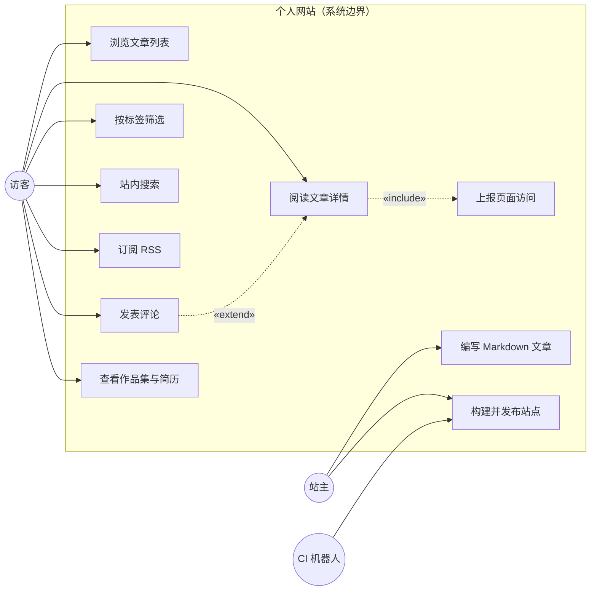

### 1.3 PlantUML

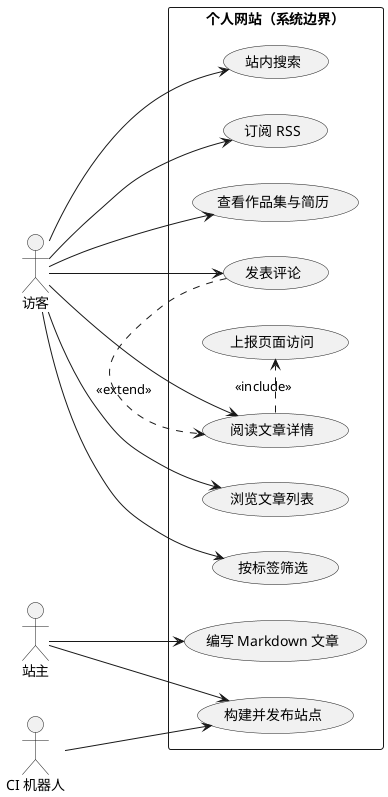

**两个关系值得讲**：

- `评论 «extend» 阅读`：评论不是必走流程，只在访客选择扩展时发生
- `阅读 «include» 上报统计`：每次阅读都必然发生，所以是 include

## 2. 领域类图（概念模型）

### 2.1 类与关系

| 类 | 关键属性 | 说明 |
| --- | --- | --- |
| Post | slug、title、date、summary、body、draft、cover | 文章，URL 由 slug 决定 |
| Tag | name、slug | 标签，N:N 关联 |
| Project | name、intro、stack、repoUrl、demoUrl | 作品集条目 |
| Page | title、body | 关于、简历等固定页 |
| SiteConfig | title、author、baseUrl、feedPath | 站点级配置 |

**边界决策**：`Comment` 不作为本站类——它由外部构件 Giscus 承担，本站模型里不建表、不做鉴权。这一条在需求阶段就定了，直接决定了后续没有后端。

### 2.2 Mermaid

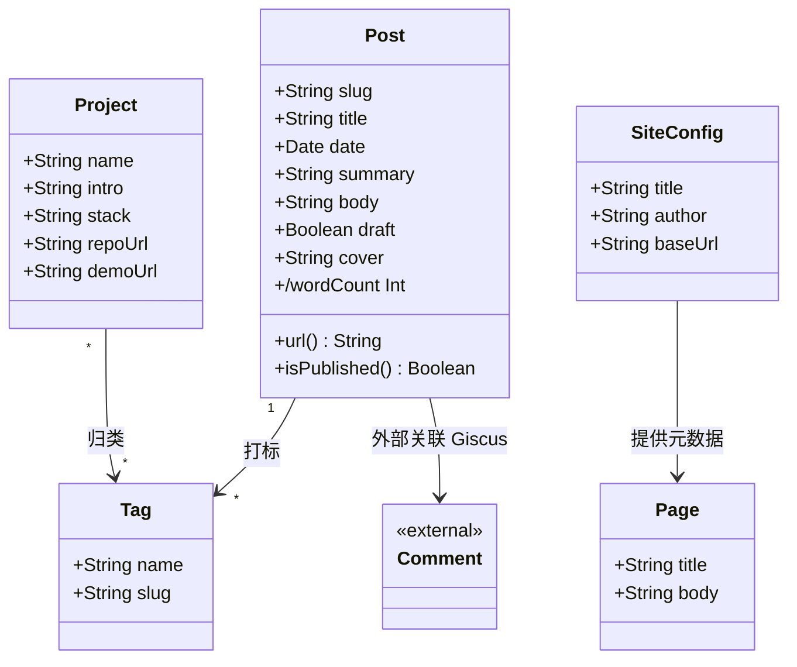

### 2.3 PlantUML

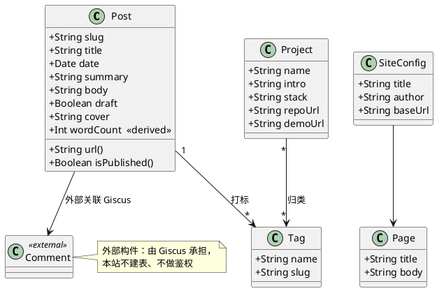

## 3. 需求级顺序图与状态图

### 3.1 顺序图：访客阅读一篇文章（含评论）

**Mermaid**

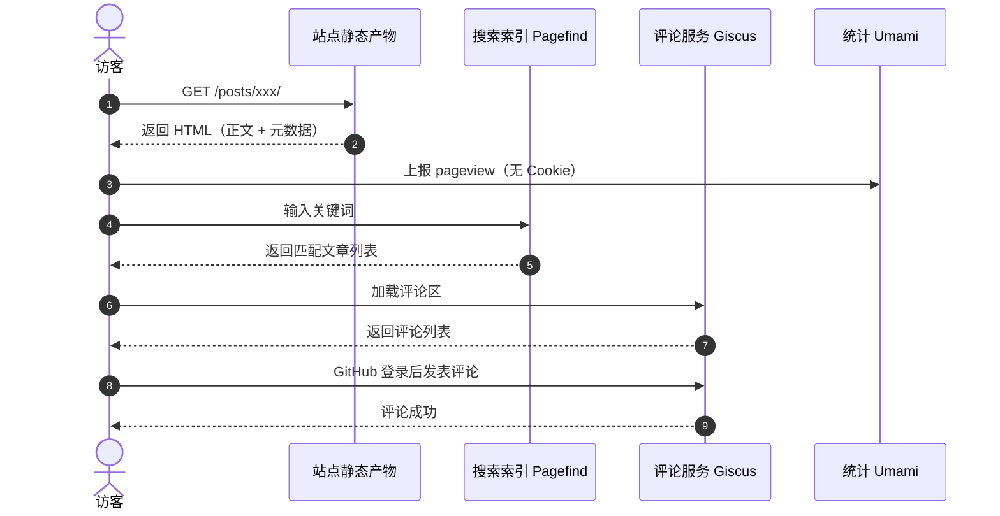

**PlantUML**

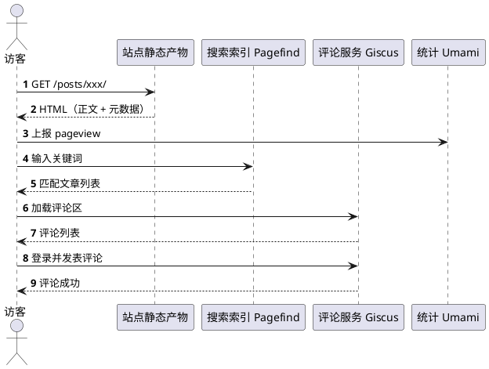

**讲解点**：整条时序里**没有本站服务端**，四个参与者全是静态文件或第三方——这就是"无后端"在需求图上的直接体现。

### 3.2 状态图：文章生命周期

**Mermaid**

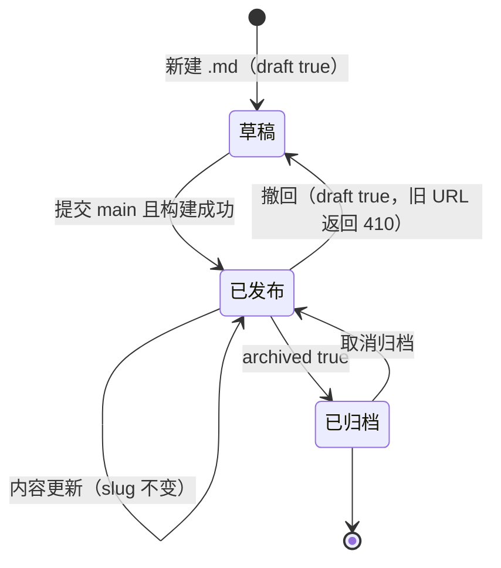

**PlantUML**

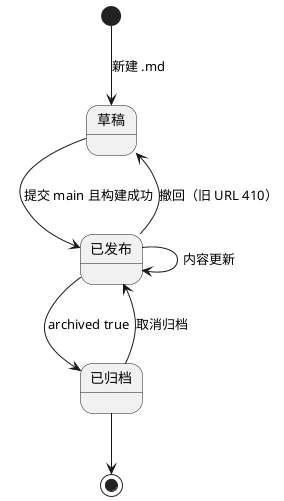

**为什么需要它**：状态图里的"撤回 → 旧 URL 返回 410"，直接生成了契约中的一条约定；没有状态图，这条规则没人会想到。

---

# 二、架构设计

## 4. 逻辑视图

### 4.1 构件与连接件

| 类别 | 元素 |
| --- | --- |
| 构件 | Markdown 内容、模板与组件、静态站点构建器、搜索索引、静态产物、CDN 边缘、评论服务（外）、统计服务（外） |
| 连接件 | 构建调用（进程内）、文件系统产物、Git 提交、HTTPS、外部 API |
| 约束 | 内容只在 Git、模板不直读内容、评论不出本站模型 |

### 4.2 Mermaid

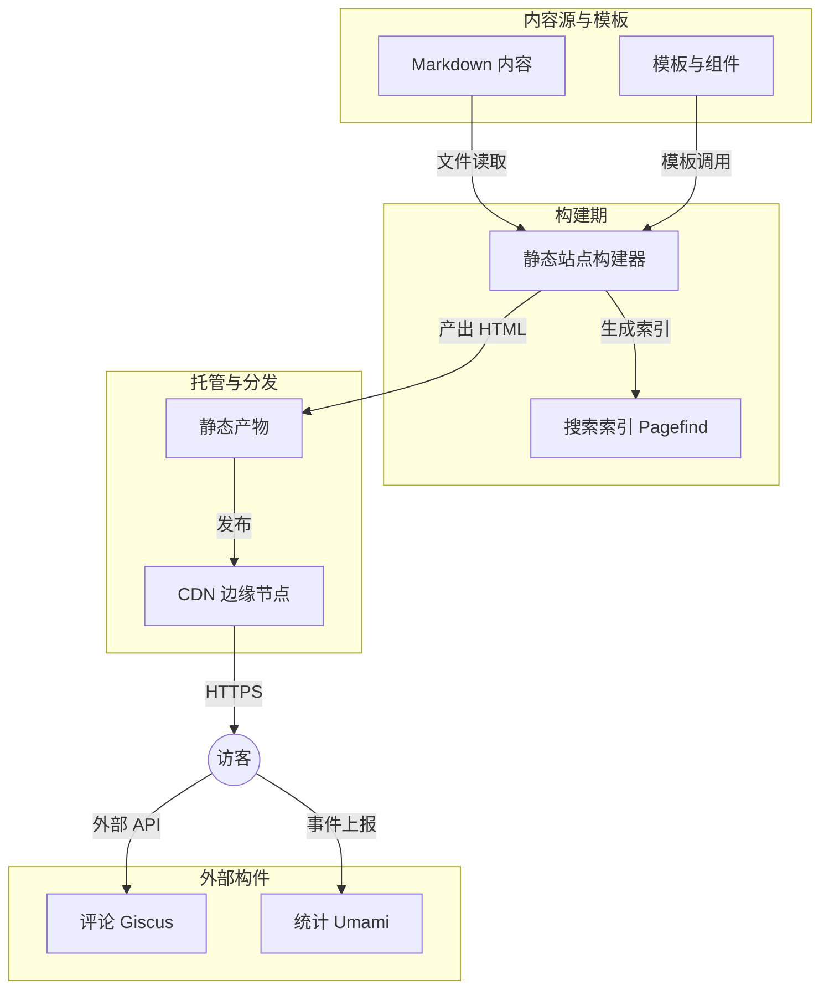

### 4.3 PlantUML

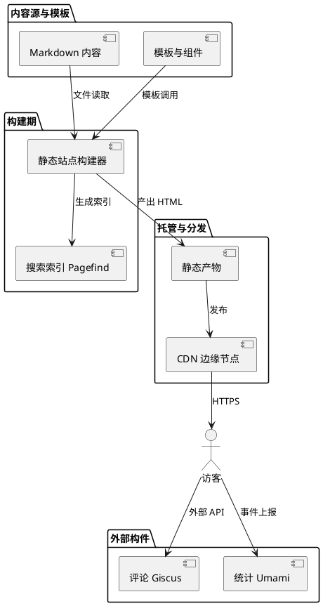

## 5. 开发视图

### 5.1 包结构与依赖规则

| 包 | 职责 | 允许依赖 |
| --- | --- | --- |
| `content/` | Markdown 源（posts / projects / pages） | 无（纯数据） |
| `layouts/` | 页面骨架 | `components/`、`lib/` 纯函数 |
| `components/` | 展示型组件，只接收 props | 不依赖 `content/`、不读文件 |
| `lib/` | 读取、路由、SEO、feed | `content/` |
| `scripts/` | 构建与检查脚本 | `lib/`、`content/` |

红线：**`components/` 与 `layouts/` 不得出现 `fs.readFile`**。

### 5.2 Mermaid

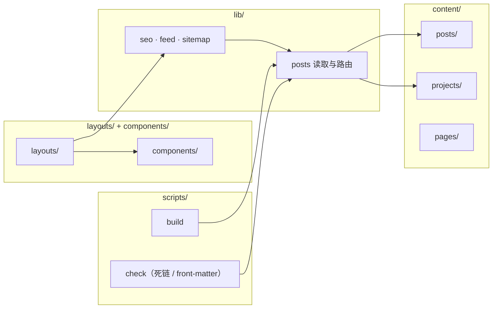

### 5.3 PlantUML

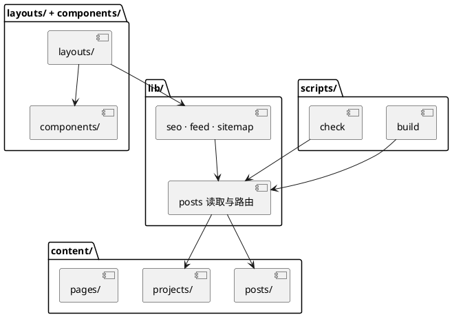

## 6. 物理视图

### 6.1 部署单元

| 部署单元 | 位置 | 说明 |
| --- | --- | --- |
| Git 仓库 | 开发机 / GitHub | 内容与模板的唯一真相 |
| CI 构建 | 托管平台 | 每次推送触发 |
| 对象存储 | 托管平台 | 存放带指纹的静态产物 |
| CDN 边缘 | 全球节点 | 承担全部访客流量 |
| GitHub Issues | 第三方 | 评论区数据 |
| Umami 实例 | 自建 VPS | 访问统计 |

### 6.2 Mermaid

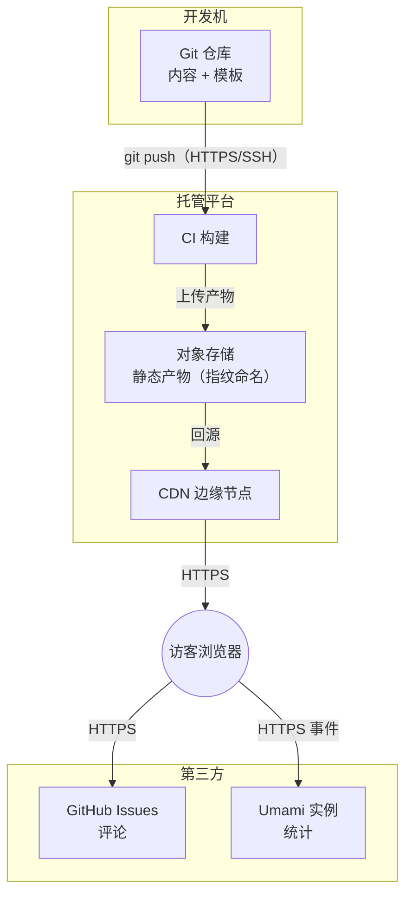

### 6.3 PlantUML

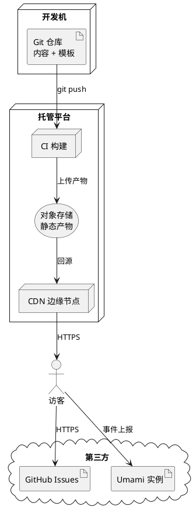

**关键**：物理图上"浏览器直连第三方"这条线，就是安全边界——评论与统计不经过本站，也不该经过。

## 7. 运行视图

### 7.1 发布流程（站主提交 → CDN 生效）

**Mermaid**

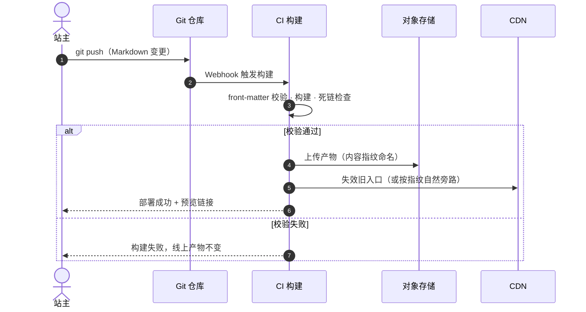

**PlantUML**

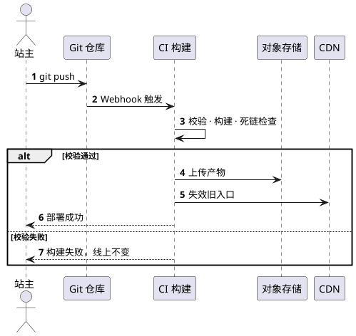

### 7.2 访客访问（缓存命中与未命中）

**Mermaid**

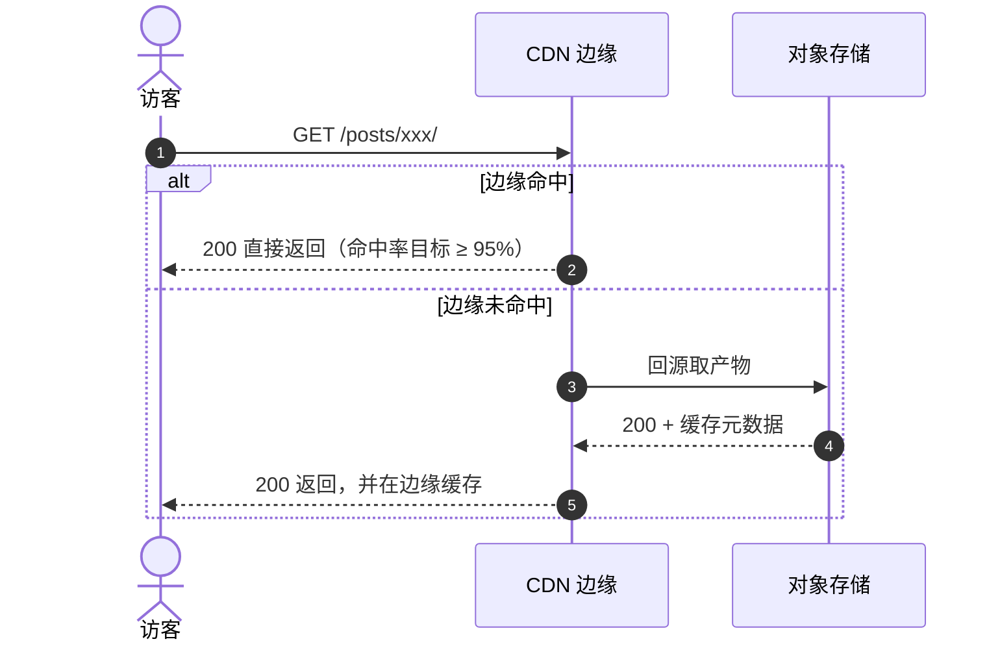

**PlantUML**

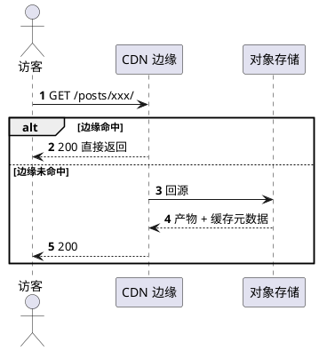

## 8. 四视图一致性核对

| 核对项 | 结果 |
| --- | --- |
| 逻辑图每个构件 → 开发图有包 | 内容→`content/`、构建器→`lib/`+`scripts/`、搜索→Pagefind 插件、评论/统计→外部 |
| 每个构件 → 物理图有部署单元 | 静态产物→对象存储+CDN、评论→GitHub、统计→Umami |
| 每条运行消息 → 有连接件 | Git 提交、构建调用、HTTPS、外部 API |
| 缺口检查 | 逻辑图有"统计"，物理图必须有 Umami，运行图必须有事件上报——第一版漏了，已补上 |

---

# 三、复用、约束与契约

## 9. 可替换点与选型

| 可替换点 | 候选 | 选定 | 理由 |
| --- | --- | --- | --- |
| 构建器 | Hugo / Eleventy / Astro / Next | Eleventy | 零运行时、构建秒级、输出纯静态 |
| 托管 | Netlify / Vercel / 对象存储 + CDN | 静态托管 | 免费额度、PR 预览、自带 CDN |
| 搜索 | Pagefind / Algolia | Pagefind | 构建时生成索引，无 API key、无外部依赖 |
| 评论 | Giscus / Disqus | Giscus | 无广告，数据在 GitHub Issues，符合"数据自持" |
| 统计 | Google Analytics / Umami | Umami | 无 Cookie、轻量，符合"不采集个人信息" |
| 图片 | 图片 CDN / 构建时压缩 | 构建时 sharp | 少一个外部依赖 |

**一次回退**：初选 GA，与"不采集个人信息"冲突 → 换 Umami。对应活动图「与架构约束冲突 → 换构件」。

## 10. 架构约束检查（七类）

| 类别 | 本项目约束 | 检查手段 |
| --- | --- | --- |
| 分层依赖 | 模板/组件不得直读 `content/` | ESLint `no-restricted-imports` + 自定义 lint 规则禁 `fs` |
| 单一出口 | 所有数据经 `lib/posts` 获取 | 代码审查 + grep `fs.readFile` |
| 幂等 | 同一 commit 重复构建产物一致 | CI 构建两次比对 hash |
| 无状态 | 托管无会话、无服务端状态 | 架构评审 |
| 权限 | 部署令牌只授单仓库；评论写权限交 GitHub 身份 | 令牌 scope 审查 |
| 性能 | 单页 HTML ≤ 100 KB、图片 WebP + 显式宽高 | Lighthouse CI 门槛 |
| 数据唯一出口 | 内容只在 Git，产物不手改 | 发布流程比对 |

## 11. 全局接口契约骨架

没有后端 API，但契约照样有三层：

| 层 | 内容 | 载体 |
| --- | --- | --- |
| 内容契约 | front-matter 字段：`title / date / tags / draft / slug / cover` | JSON Schema，缺字段构建失败 |
| URL 契约 | `/posts/{slug}/`、`/tags/{tag}/`、`/projects/{slug}/`、`/feed.xml`、`/sitemap.xml` | 路由规则表 + 301 迁移表 |
| 外部契约 | Giscus 参数（repo / category / mapping）；Umami 事件名（`pageview / share / outbound`） | 组件封装 + 常量文件 |

错误约定：404 页面、410 弃用页（对应状态图"撤回"）、RSS 必须通过 feed 校验器。

权限矩阵：

| 主体 | 认证方式 | 边界 |
| --- | --- | --- |
| 访客 | 无 | 只读 |
| 站主 | GitHub 身份 | 可写 Git |
| CI 机器人 | 部署令牌（单仓库） | 只构建发布 |
| 评论者 | GitHub OAuth | 只能在自己权限范围内写评论 |

---

# 四、脚手架、切片与详细设计

## 12. 脚手架

```
content/  layouts/  components/  lib/  scripts/  static/
package.json（build / serve / lint / check）
.github/workflows/deploy.yml
```

必备能力：front-matter 校验、死链检查（lychee）、Lighthouse CI、预览部署、404 页、RSS 与 sitemap。

完成标志：本地 `npm run build` 出产物，CI 能出预览链接。

## 13. 切片

| 切片 | 范围 | 端到端验收 |
| --- | --- | --- |
| S1 | 首页 + 文章列表 + 详情 | 访问 `/` 看到 3 篇文章 → 点进详情看到正文 |
| S2 | 标签页 + RSS + sitemap | `/tags/教学/` 列出对应文章；`/feed.xml` 通过校验器 |
| S3 | 搜索 | 输入关键词出结果，索引来自真实构建 |
| S4 | 作品集 + 简历 | 页面可访问、无死链 |
| S5 | 评论（外部构件） | 发一条评论，GitHub 出现对应 discussion |
| S6 | 统计 + 404 + 301 | 造一个旧 URL，跳转到新地址 |

S1 的四项端到端检查：验收脚本可写成"当访问 `/` 时应看到 3 篇文章"；无 mock 与 TODO；产物文件真实存在；坏路径 `/nope` 返回 404 页面。

## 14. 详细设计（以 S1 为例）

| 项 | 内容 |
| --- | --- |
| 内容模型 | `content/posts/*.md`，permalink `/posts/{slug}/`，列表每页 10 篇 |
| 构件 | `Layout` / `PostList` / `PostCard` / `TagList` / `SEO`，只接收 props |
| 渲染 | 构建时生成，无运行时；缓存靠指纹文件名 + CDN TTL |
| 约束落地 | 图片缺 `alt` 构建失败；模板出现 `fs.` 直接报错 |
| 异常路径 | 文章不存在 → 404；已撤回 → 410 |

---

# 五、走查结论

1. **小项目不用减步骤，只需每步更薄**：这份走查十四个环节一个没省，但每步只有一两张表、一两张图。
2. **需求阶段的两个决策决定了整个架构**：评论判为外部构件、内容以 Git 为唯一真相——这两条一定，后端就不需要了。
3. **状态图生成了契约**："撤回 → 410"这条规则不是从架构图来的，是从状态图来的。
4. **一致性核对抓出了真缺口**：统计构件在逻辑、物理、运行三张图里对不上，说明架构没落地，不是画错图。
5. **复用会回退**：GA 换成 Umami 这一次，正好演示了活动图里那条"换构件"的边。

---

# 六、渲染方式

| 工具 | 用法 |
| --- | --- |
| Mermaid | VS Code 插件 / mermaid.live / `npx @mermaid-js/mermaid-cli -i x.md -o x.png` |
| PlantUML | VS Code PlantUML 插件 / `java -jar plantuml.jar x.puml -tpng` |
| 语法自查 | Mermaid 在 VS Code 预览即时校验；PlantUML 用 `-syntax` 参数只做语法检查 |
